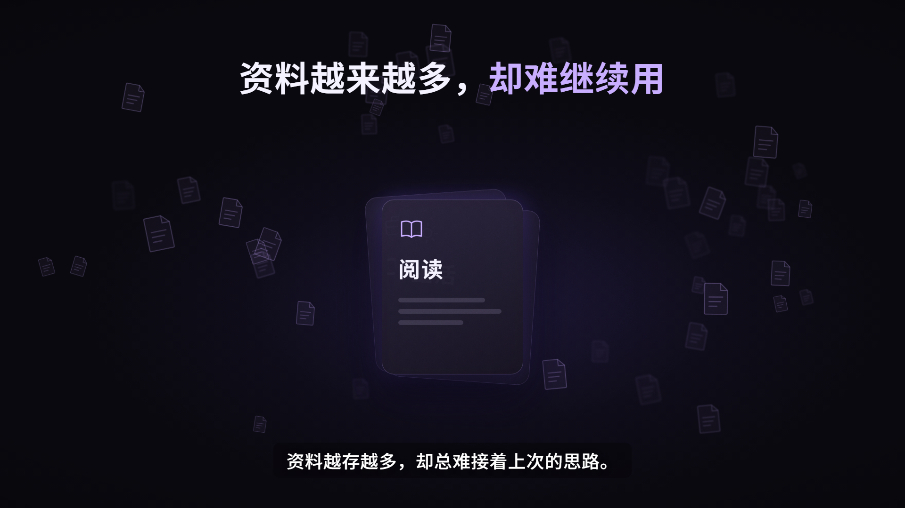
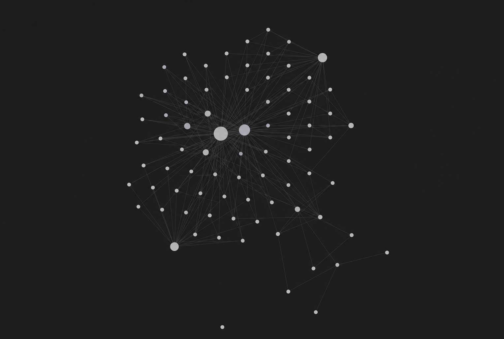
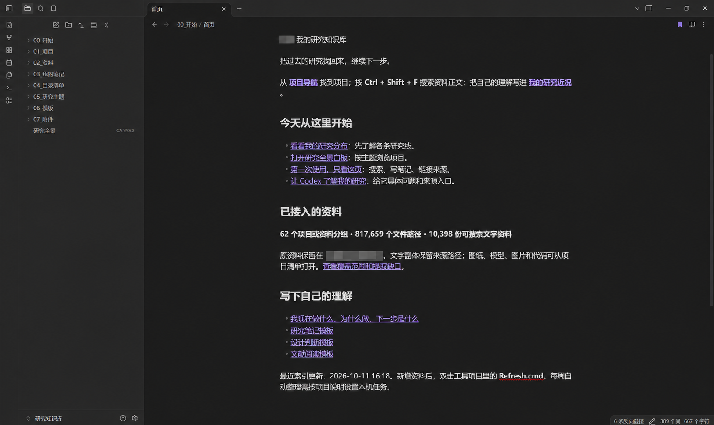
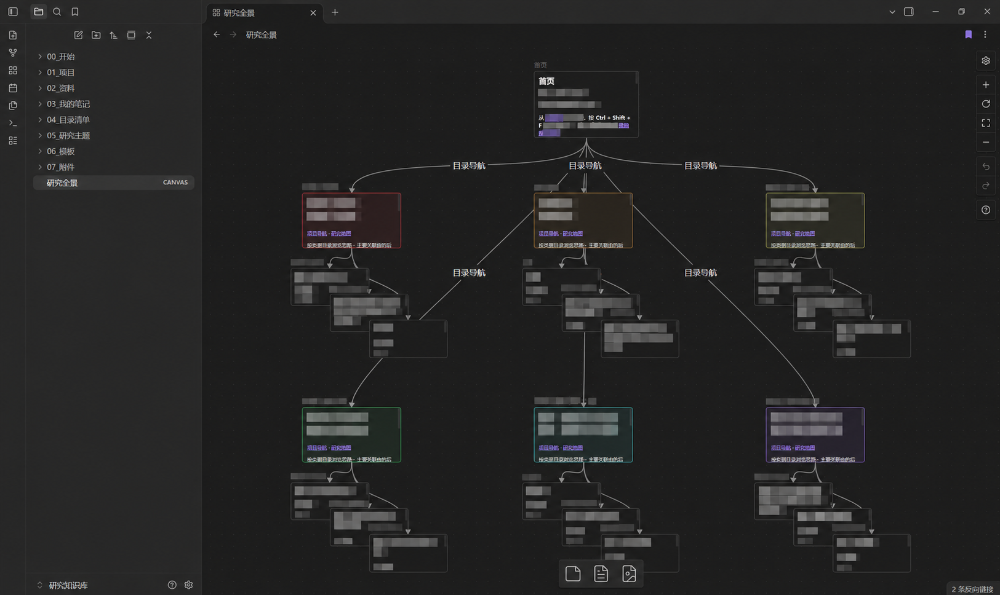
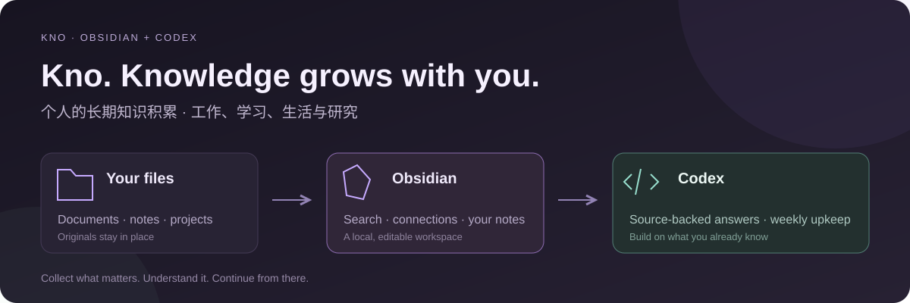
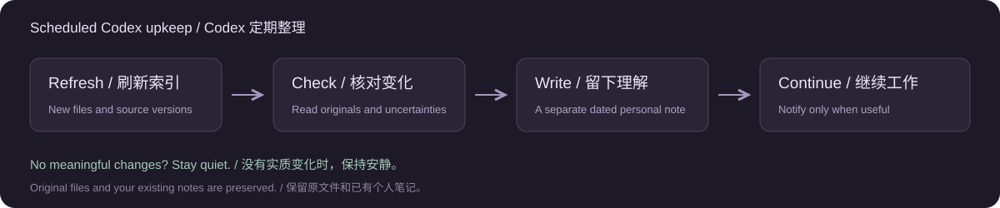

<p align="center">
  <a href="README.md">简体中文</a> · <a href="README.en.md">English</a>
</p>

<h1 align="center">Kno</h1>

<p align="center"><strong>Turn scattered files into a personal knowledge base you can build on.</strong></p>

<p align="center">Keep sources and insights in Obsidian · Let Codex answer from evidence · Review changes on a schedule</p>

<p align="center">
  <a href="https://github.com/renyuxin6666-tech/kno/actions/workflows/test.yml"></a>
  <a href="LICENSE"></a>
  
</p>

## What is Obsidian?

[Obsidian](https://obsidian.md/) is a knowledge management app that saves notes on your own device. You can write and search notes, link related ideas, and use a canvas to organize material and projects. A **vault** is the folder containing your notes. Notes are ordinary Markdown text files you can keep and edit over time.

**Kno helps you get started with it.** Obsidian stores, displays and connects your notes. These tools turn existing files into source-linked navigation and searchable extracts. Codex helps you find relevant material, check originals, save insights and organize changes on your chosen schedule. Start with work, learning, personal life or research files.

<p align="center"><a href="#get-started">Get started</a> · <a href="#see-a-real-workspace">Screenshots</a> · <a href="#let-codex-build-on-your-knowledge">Use with Codex</a> · <a href="#weekly-upkeep">Weekly upkeep</a> · <a href="#faq">FAQ</a></p>

## Meet Kno in 30 seconds

[](https://github.com/renyuxin6666-tech/kno/releases/download/v0.2.1/kno-launch-16x9.mp4)

**Click the cover to watch or download.** [Chinese-subtitled version](https://github.com/renyuxin6666-tech/kno/releases/download/v0.2.1/kno-launch-16x9.mp4) · [Version without burned-in subtitles](https://github.com/renyuxin6666-tech/kno/releases/download/v0.2.1/kno-launch-16x9-clean.mp4) · [Chinese SRT captions](https://github.com/renyuxin6666-tech/kno/releases/download/v0.2.1/kno-launch.zh-CN.srt)

Both versions are 1080p, 30 fps and 30.5 seconds, with Chinese narration and music. [Video details](docs/launch-video.md)

## Get started

In a **local Codex desktop task** with access to your files, send one message:

> Install https://github.com/renyuxin6666-tech/kno, connect my “files folder” for long-term knowledge and project management, create an English workspace, and organize it every Sunday at 20:00 in my time zone.

Replace “files folder” with its actual path, or ask Codex to help select one. It reuses installed software, builds the vault, checks that it opens, and creates or updates a task where the client supports local scheduling. Initial setup needs network access, available Python / Obsidian installation methods, and the relevant permissions. Codex should explain any missing requirement.

**Start with the folders you already have.** Work, reading, courses, personal plans, creative projects and research all fit; you do not need to learn commands first.

## See how notes connect



*An actual Obsidian graph capture, with private note names hidden for public display.*

**Dots are notes; lines are links between them.** Hover to see connections, click to open a note, use colored groups for topics, or explore one note's local graph. [Obsidian graph guide](https://obsidian.md/help/plugins/graph).

Graph shows links between notes, including links from automatic navigation. Canvas is a whiteboard for arranging cards and material. Follow a link back to its note to keep reading and check its context.

<details>
<summary>Build a vault on Windows without Codex</summary>

1. Download a ZIP from [Releases](https://github.com/renyuxin6666-tech/kno/releases/latest) and extract it into a stable, writable folder.
2. For an English vault, run `powershell -NoProfile -File scripts/bootstrap.ps1 -Language en`. **Start.cmd** uses Chinese by default. Select your source folder.
3. When the home page opens, use **Ctrl + Shift + F** to search and save your own insights under **My Notes**.

The English default is `.runtime/workspace/Personal Knowledge`. **Refresh.cmd** updates the index; **Open.cmd** opens the home page. Large initial scans and Obsidian's own search indexing take time.

Existing Python 3.11+ and Obsidian are reused; missing software is installed through Windows Package Manager when available. If `winget` is missing, install [Microsoft App Installer](https://learn.microsoft.com/en-us/windows/package-manager/winget/). Obsidian comes from its own distribution channel: [official download](https://obsidian.md/download).

</details>

## See a real workspace



*An actual local vault capture, shown in Chinese, with author identifiers, local paths and private project labels covered. Source navigation, coverage and personal notes are kept together.*



*An actual Obsidian Canvas map with private project labels covered. It helps you find material; you confirm project status and accepted conclusions. This existing research example retains its original names; new vaults use general names.*

## Keep knowledge useful over time



| What you collect | How the workspace helps |
| --- | --- |
| Projects, meetings and work documents | Find relevant sources, record decisions and next steps, retain versions |
| Reading, courses and ongoing learning | Search extracts, connect topics and save your own understanding |
| Creative work and personal plans | Gather source links, record choices and conditions, continue earlier work |
| Papers, experiments and research | Check original evidence, versions, extraction gaps and open questions |

Original files stay where they are. The vault holds navigation, text snapshots, source links and your notes. Images, code, models and large assets are mostly referenced by their original paths.

| Vault entry | English / Chinese | Purpose |
| --- | --- | --- |
| Start | `00_Start` / `00_开始` | Home, knowledge map, guidance, coverage and gaps |
| Projects and topics | `01_Projects`, `05_Topics` / `01_项目`, `05_主题` | Source-based navigation you can reorganize |
| Sources | `02_Sources` / `02_资料` | Text snapshots with original source paths |
| My notes | `03_My_Notes` / `03_我的笔记` | Current focus, your judgments and upkeep records |
| Lists and templates | `04_File_Lists`, `06_Templates` / `04_目录清单`, `06_模板` | Non-text asset links and knowledge, reading and decision templates |

Language selection covers new vault pages, templates and working instructions. Existing vault paths and handwritten notes are preserved; the original research vault is not automatically renamed.

## Let Codex build on your knowledge

> Find relevant material in my knowledge base, check the originals before answering, and save the supported conclusions as a personal note.

Fill in **My Current Focus / 我的近况** with your priorities, current work and open questions. Empty fields remain unknown. Folder names and file dates cannot establish your current intentions.

Kno packages a Codex plugin with three workflows:

| Workflow | Purpose |
| --- | --- |
| `$setup-knowledge` | Install the tool and create or connect a local vault |
| `$knowledge-retrieval` | Read bounded source excerpts and check versions before answering |
| `$maintain-knowledge` | Refresh changes, write separate interpretation notes and manage scheduled upkeep |

Distribution uses this repository's [marketplace](.agents/plugins/marketplace.json). This is a local / repository installation source; the plugin is not listed in the universal public Plugins Directory. Supported clients can load the workflows, and ordinary local Codex tasks can use the pipeline through its project instructions. [Plugin installation and management](docs/codex-plugin.md) · [OpenAI plugin packaging](https://developers.openai.com/plugins/build/plugins).

Retrieval checks whether an original still exists and whether its hash matches the extract, then returns to the source. **Other chats need directory access and must actually read the material.** The vault does not create permanent memory across all models or chats.

## Weekly upkeep



The first installation message includes Sunday at 20:00. You can change it later:

> Move knowledge-base upkeep to Fridays at 18:00. Stay quiet when there is nothing useful to report; notify me about important changes, clear conflicts or failures.

Each run refreshes the index, reads that run's changes and checks relevant originals. Automatic change records and the agent's interpretation are saved separately. Original files and personal notes are preserved. Existing matching schedules are reused or updated. [Full upkeep prompt](docs/automation.en.md).

For local scheduled work, the computer and desktop app must be running and the folder accessible. Web tasks cannot directly organize local folders. See [OpenAI scheduled-task guidance](https://learn.chatgpt.com/docs/automations).

For index updates only, **Enable-Weekly.cmd** creates a Windows task with no model calls. Choose this or Codex scheduled upkeep to avoid duplicate refreshes. GitHub Actions tests synthetic examples; it cannot access your files.

## FAQ

**Are originals moved or overwritten?** Original sources are read-only. New content goes into the vault. Refresh protects personal notes and manually edited generated pages. Historical extracts can remain after a source is deleted, so check source existence before citing them.

**Are my files uploaded to GitHub?** Releases contain tools, documentation, redacted images and synthetic tests. Local settings and vault data are excluded. Content selected for Codex remains subject to the product's data settings. [Privacy and data boundaries](docs/privacy.en.md).

**Does it fully understand scans, images or CAD?** OCR, semantic retrieval and complete image / model understanding are not implemented. Text extraction for PDFs, Word and slides has limits, recorded in the coverage report. Consequential conclusions need original-source checks.

**Is it just for research?** It covers work, learning, creative projects, personal planning and research. The project is **Kno**, with the GitHub repository named `kno`. Existing local vaults keep working with their current folders, settings and schedules.

**Which systems are supported?** Desktop launchers target Windows 10/11. The Python pipeline is tested in Windows / Linux CI; installation and desktop integration on other systems need manual setup. The missing-software WinGet branch exists but has not completed acceptance testing on a fresh Windows computer.

<details>
<summary>Development, commands and current limits</summary>

Python 3.11+. Run from the repository root:

```powershell
python -m pip install -r requirements.txt
python scripts/pipeline.py setup --source "C:/Knowledge" --workspace ".runtime/workspace" --language en
python scripts/pipeline.py context --config settings.local.json --query "decision conditions" --limit 8
python -m unittest discover -s tests -v
```

`context` returns current focus, coverage and bounded source excerpts. `search --paths` finds non-text assets. `settings.local.json` contains private local paths, language and category rules; keep it untracked.

Scanning and extraction have file-size, character, page and time limits. A full refresh still scans directories and builds a large asset catalog in memory. Moving originals requires path updates. There is no OCR, semantic retrieval, cross-device sync or background cloud service. Possible extensions include local full-text search, optional OCR, stable document IDs, per-project incremental refresh and scoped MCP retrieval.

Synthetic tests cover source preservation, changes, note protection, historical snapshots, source hashes, Chinese-path opening and language modes. Passing tests does not validate every new-machine installation or the content of your conclusions. [Release notes](docs/release-notes.md).

</details>

Code uses the [MIT License](LICENSE). Obsidian, dependencies and your files retain their respective licenses.
